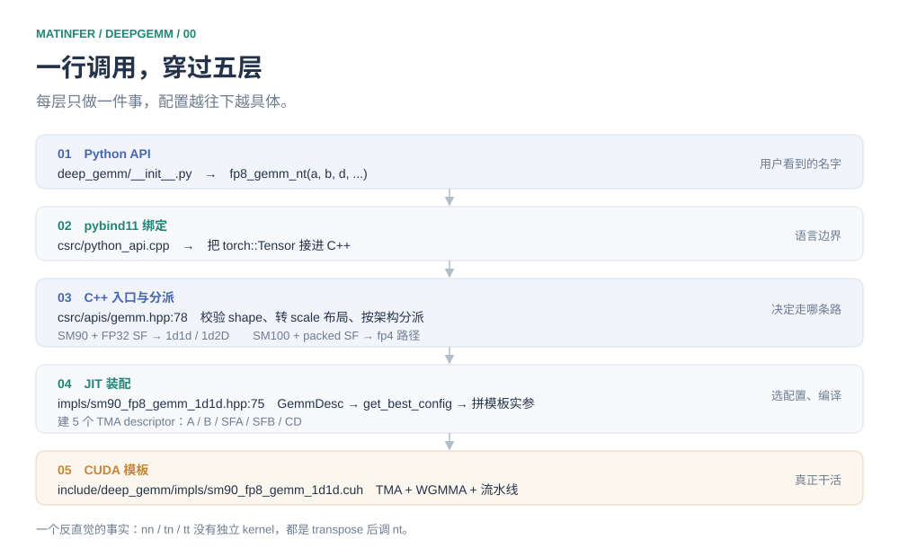

# Day 01｜一行 `fp8_gemm_nt`，穿过五层

用户调用 DeepGEMM 时写的是一行 Python：

```python
deep_gemm.fp8_gemm_nt(a, sfa, b, sfb, d)
```

从这行到 GPU 上真正跑起来的那个 kernel，中间隔着五层。每一层只做一件事，而且做的事越来越具体：Python 侧决定**叫什么名字**，绑定层跨**语言边界**，C++ 入口决定**走哪条路**，JIT 层决定**用哪组配置编译**，最后的 CUDA 模板才决定**数据怎么搬、怎么算**。

这篇就把这五层走一遍。走完你会拿到三样东西：一张能背下来的调用链、一个反直觉的布局事实、以及"为什么安装时不编译 CUDA"这个问题的答案。

**本文基于本地浅克隆 commit `5081f851`（版本 2.8.2）**。DeepGEMM 在 2026 年持续演进，行号可能漂移，路径和机制是稳定的。硬件门槛先放这儿：主库只支持 SM90（H100/H800）与 SM100（B200/GB200），CUDA 12.9+、C++20；4090（SM89）、3090（SM86）跑不了，A100 只有 `deep_gemm/legacy/` 下一套 Triton 实现。所以这篇是源码阅读，不是本机实测。



*图 1　调用链的纵深。越往下配置越具体，越往上名字越接近用户。*

## 第一层：Python 侧只做导出

`deep_gemm/__init__.py` 是整个库的门面。它做两件事：把 C++ 扩展里的函数 re-export 成顶层 API，末尾再 try-import 一份 legacy Triton 实现——这就是 A100 用户还能用的那条路。版本号 `2.8.2` 也写在这个文件末尾（`:127`）。

这一层没有逻辑，不需要停留。它的价值只是告诉你：**你调用的 `fp8_gemm_nt` 不是 Python 写的**，真正的入口在 C++。

## 第二层：pybind11 跨语言边界

`csrc/python_api.cpp` 把 Python 的 tensor 转成 `torch::Tensor`，注册成模块函数。调用从这里进入 C++ 世界。同样没有决策，只有类型转换。

## 第三层：C++ 入口做分派，这是最关键的一层

`csrc/apis/gemm.hpp:78` 的 `fp8_fp4_gemm_nt` 是真正的核心入口。它按顺序做四件事：

1. **校验**（`:101-103`）：拿 `arch_major`，检查 A、B 的 shape、major、dtype，确认 K 对得上。
2. **早退**（`:109` 附近）：M/N/K 为 0 时直接返回；`c` 有值则走累加语义。
3. **转 scale 布局**（`:113`）：`layout::transform_sf_pair_into_required_layout`。这一步看着像预处理，其实是硬件约束的集中体现——后面单独讲。
4. **架构分派**（`:117-131`）：决定调用哪个 kernel 文件。

分派逻辑值得逐字读（`:117-131`）：

```cpp
if (arch_major == 9 and sfa.scalar_type() == torch::kFloat) {
    const int gran_n = recipe.has_value()
        ? std::get<1>(recipe.value()) : std::get<0>(recipe_b.value());
    if (gran_n == 1)
        sm90_fp8_gemm_1d1d(...);
    else
        sm90_fp8_gemm_1d2d(...);
} else if (arch_major == 10 and sfa.scalar_type() == torch::kInt) {
    sm100_fp8_fp4_gemm_1d1d(...);
} else {
    DG_HOST_UNREACHABLE("Unsupported architecture or scaling factor types");
}
```

三个判断把整座库的分支结构摊开了：

- **架构 + scale 类型**先分层：SM90 的 scale 是 FP32，SM100 的 scale 是打包进 `int32` 的 UE8M0。两者不可能走同一条路。
- **SM90 内部按 `gran_n` 再分**：`gran_n == 1` 走 1D1D（A、B 的 scale 都沿 K 每 128 个值一个）；否则走 1D2D（B 侧在 N 方向按块共享 scale，典型是 per-channel 权重量化）。两个文件代码量 10KB vs 18KB，差出来的就是这组额外的 scale 加载。
- **其余直接不可达**：不支持的组合不兜底、不降级，直接报错。这种"窄"是刻意的——它把优化空间收拢到少数几条路径上。

### 一个能拉开差距的细节

`gemm.hpp:135-179` 里还有 `fp8_fp4_gemm_nn`、`tn`、`tt` 三个函数。它们**没有独立 kernel 实现**——内部只是把 A 或 B transpose 一下，然后调 `fp8_fp4_gemm_nt`（`:146`、`:161`、`:177`）。

所以 README 说 SM100 支持四种 layout，核心 kernel 其实只有 NT 一套。面试被问"支持哪些布局"时，把这个说出来，和背 README 是两个层次。

## 第四层：JIT 装配，配置在这里变成编译期常量

分派进入 `csrc/jit_kernels/impls/sm90_fp8_gemm_1d1d.hpp` 后，做的是同一件事：**把运行时才知道的值，变成编译期的模板实参**。

流程是这样的：

1. 用 M/N/K、dtype、major、是否累加、SM 数量、TC 利用率等字段构造一个 `GemmDesc`（`:85` 附近）。
2. `get_best_config<SM90ArchSpec>(desc)` 从这个描述里解出 block 形状、swizzle 模式、流水线级数、线程数。
3. `jit->compile` 拼一段 C++ 源码字符串，把上述值全部填进 `sm90_fp8_gemm_1d1d_impl<...>` 的模板参数表，现场编译。
4. `jit->launch` 用编译好的函数指针启动。

启动配置里的这一行解释了另一个常见疑问（`:125` 附近）：

```cpp
.grid_dim = dim3(config.launch_config.num_sms, 1, 1)
```

Grid 大小等于 SM 数量，不是输出块数——这是个 **persistent kernel**：固定数量的 CTA 驻留，各自循环领取工作，而不是每块输出起一个 CTA。为什么这么设计，属于 CTA Tiling 那一层的问题，[那篇文章](../../05-kernel-engineering/deepgemm/cta-tiling.md)已经展开。

**安装期不编译 CUDA 的原因也在这里**：配置要等看到具体 shape 才能定，编译必须推迟到运行时。代价是每种新 shape 第一次调用会有 JIT 冷启动；收益是同一 shape 的后续调用跑的是完全常量化的专用 kernel。这是一个用编译时间换运行效率的交换。

## 第五层：CUDA 模板才是真正干活的地方

最后落到 `deep_gemm/include/deep_gemm/impls/sm90_fp8_gemm_1d1d.cuh`。到这里才回答"数据怎么搬、怎么算"：TMA 描述符怎么取、WGMMA 怎么发、swizzle 怎么避 bank conflict、流水线怎么把搬运和计算重叠。

这篇不进去。它的入口在 [CTA Tiling](../../05-kernel-engineering/deepgemm/cta-tiling.md)，那里从算术强度 0.5 FLOP/B 起手，一路推到 block 尺寸被寄存器和片上容量卡住的位置。本文停在这层门口。

## 为什么 scale 要单独做一次布局转换

第三层里那个 `transform_sf_pair_into_required_layout` 值得多说一句，因为它是面试高频，也是最容易跳过的一步。

两个约束叠在一起：

- **TMA 的对齐要求**：scale 张量的最后一维必须 16 字节对齐，所以内存布局是 MN-major，`stride(-2) = 1`、`stride(-1) = align(mn, 4)`。
- **指数域要求**：SM90 的 scale 必须是 2 的幂（device 端有断言 `(value & 0x807fffff) == 0`），这样硬件可以用指数加法代替乘法；SM100 则把 4 个 UE8M0 指数打包进一个 `int32`。

所以用户传进来的 scale 布局，和 kernel 能通过 TMA 高效读取的布局，本来就不是一回事。转换不是多余的拷贝，而是把"用户方便表达的量化参数"翻译成"硬件方便消费的格式"。`docs/scaling-factor-format.md` 有完整的契约表和 dispatch 规则，读源码前先读它。

**边界说明**：这里的 scale 规则以 2026 年 10 月主线为准。FlashMLA、DeepGEMM 都在 2026-09-30 前后改过格式，跨版本对照代码时不要混用结论。

## 面试速查

| 问题 | 要点 |
| --- | --- |
| DeepGEMM 的调用链是怎样的？ | Python 导出 → pybind11 → `gemm.hpp:78` 分派 → JIT 装配模板 → CUDA kernel。五层，每层一个职责。 |
| 为什么安装时不编译 CUDA kernel？ | 配置依赖具体 shape，只能运行时定；JIT 把配置编译期常量化，代价是首次冷启动。 |
| SM100 支持四种 layout，有四个 kernel 吗？ | 没有。nn/tn/tt 都是 transpose 后调 nt，核心 kernel 只有 NT 一套。 |
| 1D1D 和 1D2D 对应什么量化场景？ | per-token/per-block 激活 + per-block 权重 → 1D1D；权重按输出通道共享 scale → 1D2D。 |
| scale 为什么要做布局转换？ | TMA 要求 MN-major + 16 字节对齐；scale 限 2 的幂以便指数加法；SM100 还要 4 个 UE8M0 打包进一个 int32。 |
| grid_dim 为什么等于 SM 数量？ | persistent kernel：CTA 固定驻留、循环领活，不是每块输出起一个 CTA。 |

## 下一步

调用链走完了，但 block 里的线程怎么分工还没说。一个 $64\times128$ 的输出块交给 128 或 256 个线程，每个线程背 $B_N/2$ 个累加器——这里只说了**数量**，没说**位置**。哪个寄存器对应输出块里的哪一格，是硬件和编译器一起定死的，摆错一格结果就错，而且不会报错。

从"会写 CUDA"到"会写 Tensor Core kernel"，门槛就在这一层。下一步写 Warp / MMA Tiling，接着往下走。

[返回 DeepSeekGEMM 专题](README.md) · [Kernel 层：CTA Tiling](../../05-kernel-engineering/deepgemm/cta-tiling.md)
