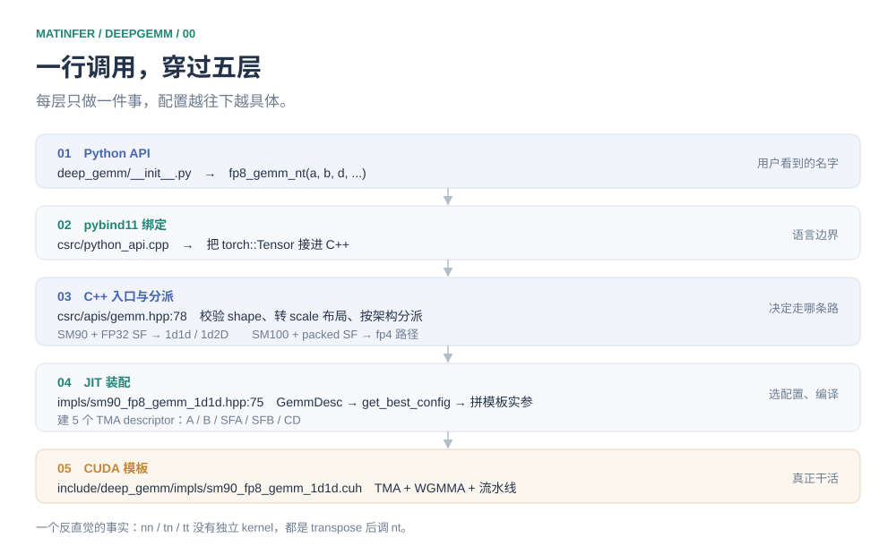
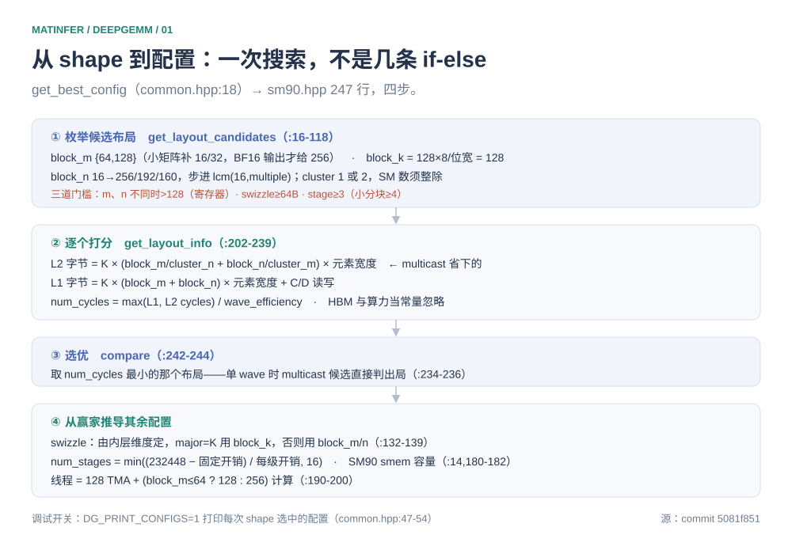

# Day 01｜一行 `fp8_gemm_nt`，穿过五层

用户调用 DeepGEMM 时写的是一行 Python：

```python
deep_gemm.fp8_gemm_nt(a, sfa, b, sfb, d)
```

从这行到 GPU 上真正跑起来的那个 kernel，中间隔着五层。每一层只做一件事，而且做的事越来越具体：Python 侧决定**叫什么名字**，绑定层跨**语言边界**，C++ 入口决定**走哪条路**，JIT 层决定**用哪组配置编译**，最后的 CUDA 模板才决定**数据怎么搬、怎么算**。

这篇就把这五层走一遍。走完你会拿到三样东西：一张能背下来的调用链、一个反直觉的布局事实、以及"为什么安装时不编译 CUDA"这个问题的答案。

**本文基于本地浅克隆 commit `5081f851`（版本 2.8.2）**。DeepGEMM 在 2026 年持续演进，行号可能漂移，路径和机制是稳定的。硬件门槛先放这儿：主库只支持 SM90（H100/H800）与 SM100（B200/GB200），CUDA 12.9+、C++20；4090（SM89）、3090（SM86）跑不了，A100 只有 `deep_gemm/legacy/` 下一套 Triton 实现。所以这篇是源码阅读，不是本机实测。



*图 1　调用链的纵深。越往下配置越具体，越往上名字越接近用户。*

## 第一层：Python 侧只做导出

`deep_gemm/__init__.py` 是整个库的门面。它做两件事：把 C++ 扩展里的函数 re-export 成顶层 API，末尾再 try-import 一份 legacy Triton 实现——这就是 A100 用户还能用的那条路。版本号 `2.8.2` 也写在这个文件末尾（`:127`）。

这一层没有逻辑，不需要停留。它的价值只是告诉你：**你调用的 `fp8_gemm_nt` 不是 Python 写的**，真正的入口在 C++。

## 第二层：pybind11 跨语言边界

`csrc/python_api.cpp` 把 Python 的 tensor 转成 `torch::Tensor`，注册成模块函数。调用从这里进入 C++ 世界。同样没有决策，只有类型转换。

## 第三层：C++ 入口做分派，这是最关键的一层

`csrc/apis/gemm.hpp:78` 的 `fp8_fp4_gemm_nt` 是真正的核心入口。它按顺序做四件事：

1. **校验**（`:101-103`）：拿 `arch_major`，检查 A、B 的 shape、major、dtype，确认 K 对得上。
2. **早退**（`:109` 附近）：M/N/K 为 0 时直接返回；`c` 有值则走累加语义。
3. **转 scale 布局**（`:113`）：`layout::transform_sf_pair_into_required_layout`。这一步看着像预处理，其实是硬件约束的集中体现——后面单独讲。
4. **架构分派**（`:117-131`）：决定调用哪个 kernel 文件。

分派逻辑值得逐字读（`:117-131`）：

```cpp
if (arch_major == 9 and sfa.scalar_type() == torch::kFloat) {
    const int gran_n = recipe.has_value()
        ? std::get<1>(recipe.value()) : std::get<0>(recipe_b.value());
    if (gran_n == 1)
        sm90_fp8_gemm_1d1d(...);
    else
        sm90_fp8_gemm_1d2d(...);
} else if (arch_major == 10 and sfa.scalar_type() == torch::kInt) {
    sm100_fp8_fp4_gemm_1d1d(...);
} else {
    DG_HOST_UNREACHABLE("Unsupported architecture or scaling factor types");
}
```

三个判断把整座库的分支结构摊开了：

- **架构 + scale 类型**先分层：SM90 的 scale 是 FP32，SM100 的 scale 是打包进 `int32` 的 UE8M0。两者不可能走同一条路。
- **SM90 内部按 `gran_n` 再分**：`gran_n == 1` 走 1D1D（A、B 的 scale 都沿 K 每 128 个值一个）；否则走 1D2D（B 侧在 N 方向按块共享 scale，典型是 per-channel 权重量化）。两个文件代码量 10KB vs 18KB，差出来的就是这组额外的 scale 加载。
- **其余直接不可达**：不支持的组合不兜底、不降级，直接报错。这种"窄"是刻意的——它把优化空间收拢到少数几条路径上。

### 一个能拉开差距的细节

`gemm.hpp:135-179` 里还有 `fp8_fp4_gemm_nn`、`tn`、`tt` 三个函数。它们**没有独立 kernel 实现**——内部只是把 A 或 B transpose 一下，然后调 `fp8_fp4_gemm_nt`（`:146`、`:161`、`:177`）。

所以 README 说 SM100 支持四种 layout，核心 kernel 其实只有 NT 一套。面试被问"支持哪些布局"时，把这个说出来，和背 README 是两个层次。

### 深入：分派用的 `recipe` 从哪来

分派代码里那个 `recipe` 不是用户凭空传的——不传时它会自己生成。这个变量决定了 1D1D / 1D2D 的分岔，值得拆开看（`csrc/apis/layout.hpp:60-87`、`csrc/utils/layout.hpp:86-97`）。

先分清两种 recipe：

- **三元组 `recipe = (gran_m, gran_n, gran_k)`**：一个 scale 值覆盖 A 的 `gran_m × gran_k` 块、B 的 `gran_n × gran_k` 块。注意它描述的是**scale 的存储粒度**，不是计算粒度（`docs/scaling-factor-format.md:15`）。
- **二元组 `recipe_a = (gran_m, gran_k)` / `recipe_b = (gran_n, gran_k)`**：A、B 用不同 K 粒度时才拆成两个。两者只能给一个，源码用 `DG_HOST_ASSERT(recipe_a.has_value() != recipe.has_value())` 卡死（`:77`）。

不传时，`get_default_recipe`（`:86`）按架构和 scale 类型给默认值：

| 架构 | scale dtype | 默认 recipe | 分派结果 |
| --- | --- | --- | --- |
| SM90 | FP32 / FP32 | `(1, 128, 128)` | `gran_n=128` → 1D2D |
| SM100 | B 侧 FP32 | `(1, 128, 128)` | legacy 格式 |
| SM100 | B 侧 INT32 | `(1, 1, 128)` | `gran_n=1` → 1D1D |

现在回头看那行分派判断就通了：`gran_n = recipe.has_value() ? std::get<1>(recipe.value()) : std::get<0>(recipe_b.value())`——三元组取第 1 位（`gran_n`），二元组 `recipe_b` 取第 0 位（也是 `gran_n`），两条路径拿到的是同一个语义，只是容器不同（`:116`）。

**一个容易记错的点**：SM90 默认走的是 **1D2D**，不是 1D1D。因为默认 recipe 的 `gran_n=128`（B 侧按 128 行共享一个 scale，典型是 per-channel 权重量化）。1D1D 在 SM90 上要显式传 `gran_n=1` 才走得到。

## 第四层：JIT 装配，配置在这里变成编译期常量

分派进入 `csrc/jit_kernels/impls/sm90_fp8_gemm_1d1d.hpp` 后，做的是同一件事：**把运行时才知道的值，变成编译期的模板实参**。

流程是这样的：

1. 用 M/N/K、dtype、major、是否累加、SM 数量、TC 利用率等字段构造一个 `GemmDesc`（`:85` 附近）。
2. `get_best_config<SM90ArchSpec>(desc)` 从这个描述里解出 block 形状、swizzle 模式、流水线级数、线程数。
3. `jit->compile` 拼一段 C++ 源码字符串，把上述值全部填进 `sm90_fp8_gemm_1d1d_impl<...>` 的模板参数表，现场编译。
4. `jit->launch` 用编译好的函数指针启动。

启动配置里的这一行解释了另一个常见疑问（`:125` 附近）：

```cpp
.grid_dim = dim3(config.launch_config.num_sms, 1, 1)
```

Grid 大小等于 SM 数量，不是输出块数——这是个 **persistent kernel**：固定数量的 CTA 驻留，各自循环领取工作，而不是每块输出起一个 CTA。为什么这么设计，属于 CTA Tiling 那一层的问题，[那篇文章](../../05-kernel-engineering/deepgemm/cta-tiling.md)已经展开。

**安装期不编译 CUDA 的原因也在这里**：配置要等看到具体 shape 才能定，编译必须推迟到运行时。代价是每种新 shape 第一次调用会有 JIT 冷启动；收益是同一 shape 的后续调用跑的是完全常量化的专用 kernel。这是一个用编译时间换运行效率的交换。

### 深入：`get_best_config` 的 247 行在算什么

"从 shape 推出四组参数"这句话背后是一套**枚举 + 模拟 + 选优**的搜索，不是几条 if-else。`csrc/jit_kernels/heuristics/common.hpp:18` 的 `get_best_config` 是入口，真正的决策在 `sm90.hpp`（247 行）里，分四步走。

**第一步：枚举候选布局**（`get_layout_candidates`，`:16-118`）。它不直接给一个答案，而是把所有合法的分块组合列出来：

- `block_m`：默认 `{64, 128}`；小矩阵（m≤16 或 ≤32）补上 16 / 32；BF16 输出才允许 256（`:23-30`）。
- `block_n`：从 16 到上限按 `lcm(16, block_n_multiple_of)` 步进。上限看 kernel 类型——普通 256、1D2D 192、1D1D 160（`:50-54`）。**1D1D + FP32 输出时起点特意从 16 跳到 24**，源码注释写得很直白："Avoid bank conflicts for 1D1D kernel FP32 output"（`:42-48`）。这是你熟悉的 bank conflict 在这个库里的具体位置。
- `block_k`：固定值 `128 × 8 / 元素位宽`——FP8 就是 128（`:60`）。
- `cluster`：1 或 2，但 `cluster_m × cluster_n ≤ 2`，且 SM 数必须能被整除（`:71-79`）。

枚举时还有三道合法性门槛：`block_m` 和 `block_n` 不能同时大于 128（寄存器不够，`:93-95`）；swizzle 模式必须 ≥ 64B（32B 性能差，`:101-103`）；流水线级数 ≥ 3，小分块要 ≥ 4（藏 TMA 延迟，`:105-108`）。

**第二步：给每个候选打分**（`get_layout_info`，`:202-239`）。这是最见功力的一段——它建了一个轻量性能模型，而不是靠经验拍板：

```
L2 字节 = K × (block_m/cluster_n + block_n/cluster_m) × 元素宽度   ← multicast 省下的
L1 字节 = K × (block_m + block_n) × 元素宽度 + C/D 读写
num_cycles = max(L1 cycles, L2 cycles) / wave_efficiency
```

带宽常数是 `L2 = min(64×SM数, 8e6/1.3e3)`、`L1 = 128×SM数`（`:212-213`）。`wave_efficiency = num_blocks / (num_waves × num_sms)` 把"最后一波填不满"的浪费算进去（`:231`）。**HBM 带宽和算力被当作常量忽略，只建模 L1/L2——因为同一 shape 下它们不随配置变化，L1/L2 才是变量**（`:227-228`）。单 wave 时直接禁用 multicast 打分（`:234-236`）。

**第三步：选 `num_cycles` 最小的**（`compare`，`:242-244`）。一个比较器，按模拟周期数排序。

**第四步：从赢家推出其余配置**。swizzle 模式由内层维度决定（major=K 时用 `block_k`，否则用 `block_m`/`block_n`，`:132-139`）；级数由共享内存容量倒算：`num_stages = min((232448 − 固定开销) / 每级开销, 16)`——232448 是 SM90 的 smem 容量（`:14`、`:180-182`）；线程数 = 128 个 TMA 线程 + （`block_m≤64 ? 128 : 256`）个计算线程（`:190-200`）。

把这套流程串起来就是一句话：**heuristics 不是"选一个模板"，而是先枚举所有合法 tiling、用一个 L1/L2 周期模型逐个打分、挑最快的那个，再把 swizzle / stage / 线程数从赢家配置里推出来**。设 `DG_PRINT_CONFIGS=1` 能看到每次选了什么（`common.hpp:47-54`）——这是调试自己 shape 的实用开关。



*图 2　`get_best_config` 的四步：枚举 → 打分 → 选优 → 推导。图里数字均来自 `sm90.hpp`。*

## 第五层：CUDA 模板才是真正干活的地方

最后落到 [`sm90_fp8_gemm_1d1d.cuh`](https://github.com/deepseek-ai/DeepGEMM/blob/5081f8513af57e61696de4f4f04b0e707ffb503e/deep_gemm/include/deep_gemm/impls/sm90_fp8_gemm_1d1d.cuh)（固定到 commit `5081f851`，与本文对应）。到这里才回答"数据怎么搬、怎么算"：TMA 描述符怎么取、WGMMA 怎么发、swizzle 怎么避 bank conflict、流水线怎么把搬运和计算重叠。

这篇不进去。它的入口在 [CTA Tiling](../../05-kernel-engineering/deepgemm/cta-tiling.md)，那里从算术强度 0.5 FLOP/B 起手，一路推到 block 尺寸被寄存器和片上容量卡住的位置。本文停在这层门口。

## 为什么 scale 要单独做一次布局转换

第三层里那个 `transform_sf_pair_into_required_layout` 值得多说一句，因为它是面试高频，也是最容易跳过的一步。

两个约束叠在一起：

- **TMA 的对齐要求**：scale 张量的最后一维必须 16 字节对齐，所以内存布局是 MN-major，`stride(-2) = 1`、`stride(-1) = align(mn, 4)`。
- **指数域要求**：SM90 的 scale 必须是 2 的幂（device 端有断言 `(value & 0x807fffff) == 0`），这样硬件可以用指数加法代替乘法；SM100 则把 4 个 UE8M0 指数打包进一个 `int32`。

所以用户传进来的 scale 布局，和 kernel 能通过 TMA 高效读取的布局，本来就不是一回事。转换不是多余的拷贝，而是把"用户方便表达的量化参数"翻译成"硬件方便消费的格式"。`docs/scaling-factor-format.md` 有完整的契约表和 dispatch 规则，读源码前先读它。

### 深入：UE8M0 打包与那个位掩码

前面说 "scale 限 2 的幂、SM100 打包 4 个进 int32"，这里把机制摊开——两句话背后是硬件格式约束。

**先看约束本身**。device 端断言是 `(value & 0x807fffffu) == 0`（`docs/scaling-factor-format.md:33`，实现在 `smxx_layout.cuh`）。把掩码拆成二进制就懂了：

```
0x807fffff = 1000 0000 0111 1111 1111 1111 1111 1111
             ^符号位    ^──── 23 位尾数 ────
```

`&` 的结果要为 0，意思是**符号位和 23 位尾数必须全是 0**，只剩中间 8 位指数域——这正是 IEEE FP32 里"2 的整数次幂"的位模式（如 1.0 = `0x3f800000`、0.5 = `0x3f000000`，尾数都是 0）。为什么强迫尾数为 0？因为硬件要用**指数加法**代替浮点乘法：scale 是 2ᵉ 时，乘 scale 等价于指数加 e，不需要真正的 FP32 乘法器。量化 kernel 侧传 `round_sf=True` 就是为了保证这个值。

**再看打包**。UE8M0 就是"无符号、8 位指数、0 尾数"的缩写——把上面那个 FP32 的 8 位指数抠出来，4 个连续的 scale 塞进一个 int32（`docs:422-431`）：

```cpp
uint32_t packed = 0;
packed |= (values[0] >> 23u);  // sf[4k+0] 的指数 → bits[7:0]
packed |= (values[1] >> 15u);  // sf[4k+1]         → bits[15:8]
packed |= (values[2] >>  7u);  // sf[4k+2]         → bits[23:16]
packed |= (values[3] <<  1u);  // sf[4k+3]         → bits[31:24]
```

FP32 的指数在 `bits[30:23]`，所以第一个右移 23 就落到最低字节；后面每个依次少移 8 位；第四个要左移 1 才能把指数顶到最高字节。移位量 23/15/7/-1 是纯位运算，没有浮点开销。打包后 `packed_sf_k = ceil_div(k, gran_k × 4)`——K 方向 4 个 4 个地合。

**最后是内存布局**。转换后的张量是 MN-major：MN 维连续（`stride(-2)=1`），K 维的 stride 是 `align(mn, 4)`（`docs:56-63`）。那个 4 来自 `ALIGN_MN = 16 bytes / 4 bytes = 4`——TMA 要求 `stride(-1)` 是 16 字节的倍数。文档给的具体例子（`:434-447`）：`mn=6` 时 `align(6,4)=8`，每个 K-slice 占 8 个 int32，前 6 个是 m0~m5，后 2 个是纯 padding，只为对齐、永不作为数据读取。

所以 `transform_sf_pair_into_required_layout` 那一步搬的不是数据值，是**把"用户按 K 连续写的 float32 scale"重排成"硬件按 MN 连续、指数打包、TMA 对齐的 int32"**。这是一次格式翻译，不是冗余拷贝。

**边界说明**：这里的 scale 规则以 2026 年 10 月主线为准。FlashMLA、DeepGEMM 都在 2026-09-30 前后改过格式，跨版本对照代码时不要混用结论。

## 下一步

调用链走完了，但 block 里的线程怎么分工还没说。一个 $64\times128$ 的输出块交给 128 或 256 个线程，每个线程背 $B_N/2$ 个累加器——这里只说了**数量**，没说**位置**。哪个寄存器对应输出块里的哪一格，是硬件和编译器一起定死的，摆错一格结果就错，而且不会报错。

从"会写 CUDA"到"会写 Tensor Core kernel"，门槛就在这一层。下一步写 Warp / MMA Tiling，接着往下走。

[返回 DeepGEMM 专题](README.md) · [Kernel 层：CTA Tiling](../../05-kernel-engineering/deepgemm/cta-tiling.md)

## 附录：一个具体 shape 从 Python 走到 WGMMA

前面五层讲的是"每层做什么"。这一节拿一个具体 shape 把数字填进去，顺便纠正一个很常见的理解：

> ❌ "无论什么 shape，第一步都是先切块，切完丢到 CUDA 上跑。"

方向没错，但有两处关键错位：

1. **GPU 上没有"切块"这个动作**。$BLOCK_M/BLOCK_N/BLOCK_K$ 是 JIT 在 host 侧由 `get_best_config` 搜出来的**编译期常量**，直接烧进模板参数。kernel 里看到的 `BLOCK_M=128` 就是字面量，不是运行时算出来的。
2. **不是"一块一个 CTA 丢上去"**。`grid_dim = dim3(num_sms, 1, 1)`——H100 是 132 个 CTA，跟输出块数无关。每个 CTA 常驻、循环 `get_next_block()` 领活，这叫 **persistent kernel**。

真正的顺序是：

| 步骤 | 在哪 | 做什么 |
| --- | --- | --- |
| ① 校验 + 分派 | host / C++ | 检查 shape、major、dtype，决定走 1D1D / 1D2D / SM100 |
| ② scale 布局转换 | host 发起 GPU kernel | 用户 float32 scale → MN-major、TMA 对齐；SM100 还要打包 UE8M0 |
| ③ JIT 搜配置 + 编译 | host | 按 shape 枚举 tiling、打分，编译专用 kernel（同 shape 只编译一次） |
| ④ launch | host | `grid = num_sms`，`block = 128 TMA + 256 math` |
| ⑤ 循环领块 | device / kernel | scheduler 算块数、swizzle、multicast，每个 CTA 领若干块 |
| ⑥ 块内 K 循环 | device / kernel | TMA 搬 → WGMMA 算 → scale 提升 → TMA 写回 |

### 把数字填进去

设 `M=4096, N=8192, K=4096`，H100（132 SM），显式给 `gran_n=1` 走正在读的 1D1D kernel，输出 BF16。下面这组 `128/128/128` 是用来走通流程的**假设配置**（真实值以 `DG_PRINT_CONFIGS=1` 打印为准），但块数、CTA 分配、K 迭代的算法都是源码原样。

| 量 | 值 | 怎么来的 |
| --- | --- | --- |
| `BLOCK_M / N / K` | 128 / 128 / 128（示例） | `get_best_config` 的候选之一；1D1D 的 `block_n` 上限 160，BF16 输出才可到 256 的 `block_m` |
| `num_m_blocks` | 4096/128 = 32 | `ceil_div(shape_m, BLOCK_M)`（`scheduler/gemm.cuh:75`） |
| `num_n_blocks` | 8192/128 = 64 | `ceil_div(shape_n, BLOCK_N)` |
| **输出块总数** | **32 × 64 = 2048** | Normal GEMM：`num_m_blocks × num_n_blocks`（`:78`） |
| **grid** | **132** | `config.launch_config.num_sms`，不是 2048 |
| block | 128 TMA + 256 math = 384 线程 | `block_m > 64` → 256 math（`sm90.hpp:191-193`） |
| K 迭代 | 4096/128 = 32 次 | kernel 内的 `num_k_blocks` |
| 每 CTA 领块 | 68 个 CTA 领 16 块，其余领 15 块 | 2048 / 132 向上取整 |

### CTA 怎么把 2048 块分完

核心就一行（`scheduler/gemm.cuh:184`）：

```cpp
const auto next_block_idx = (++ current_iter) * kNumSMs + blockIdx.x;
```

CTA 0 拿到编号 0、132、264、…、1980；CTA 1 拿到 1、133、265、…；CTA 131 拿到 131、263、…。`get_next_block` 在 `next_block_idx >= num_blocks` 时返回 false，这个 CTA 就收工。最后一波只有 68/132 的占用——这正是 heuristics 里 `wave_efficiency` 要建模的浪费。

拿到线性编号后，还要 `get_swizzled_block_idx` 重排成 `(m_block_idx, n_block_idx)`，不是简单除法。比如 `kIsMulticastOnA=false`、每组 8 块时，编号 132 映射为 `(m=4, n=16)`，编号 133 是 `(m=5, n=16)`：相邻 CTA 落在同一 N 组的不同 M 行，B tile 可以一次加载 multicast 给多个 CTA。**swizzle 是为 L2 局部性和 TMA multicast 服务的**，不是随便打乱。



*图 3　persistent 调度：grid 固定为 SM 数，CTA 按 `iter × 132 + blockIdx.x` 循环领块。*

### 一块 128×128 输出是怎么算出来的

CTA 领到 `(m_block_idx, n_block_idx)` 后，两拨线程分工：

- **TMA warp-group**（128 线程，其中 1 个发起 copy）：按 stage 把 A 的 128×128 tile、B 的 128×128 tile、对应的 sfa/sfb 搬进 shared memory。`full/empty` barrier 做生产者-消费者握手，`get_pipeline(iter)` 用 `iter % kNumStages` 选 stage、`(iter / kNumStages) & 1` 翻 phase。
- **math warp-groups**（256 线程）：等 full barrier → 读 scale → 每条 K 迭代发 `BLOCK_K / WGMMA::K = 128/32 = 4` 条 WGMMA → `commit_batch` → `wait<0>` → 用 `scale_a × scale_b` 做 2×2 外积提升 → arrive empty barrier。

32 次 K 迭代结束后，`final_accum` 就是这 128×128 的结果：先写 smem，再用 `cute::SM90_TMA_REDUCE_ADD_2D::copy` 写回全局 D——累加语义（`c` 有值时）就靠这个 TMA reduce-add。

**关键点：accumulator 一直留在寄存器里**，32 轮 K 从未写回显存。这就是 K 不单独切给 CTA、而是在块内循环的原因：切出去就得把部分和搬来搬去，反而更慢。

### 面试时怎么用这个例子

被问"DeepGEMM 怎么处理大矩阵"，不要答"切块后丢上去"，要答三层：

1. **编译期**：shape 决定 BLOCK_M/N/K、swizzle、stage、线程数，JIT 编译出专用 kernel；
2. **启动期**：grid = SM 数，persistent CTA 常驻；
3. **运行期**：scheduler swizzle 领块，块内 K 循环 + 多级流水，TMA 搬、WGMMA 算、scale 提升、TMA 写回。

能报出 `2048 块 / 132 CTA / 每 CTA 约 16 块` 这组数，比背 API 有用得多。
