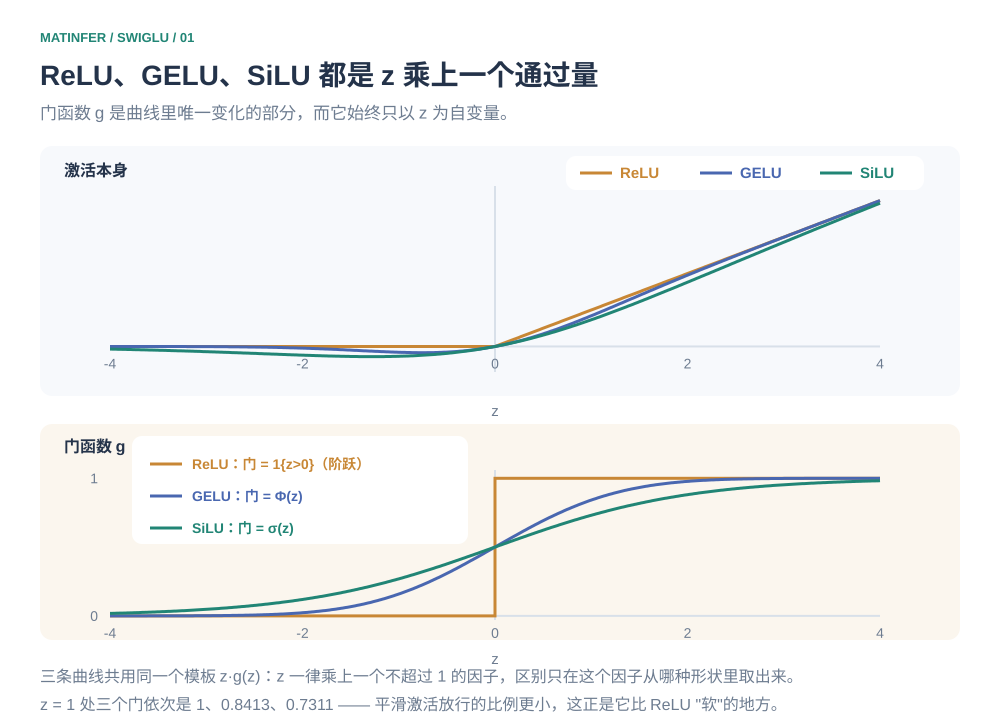
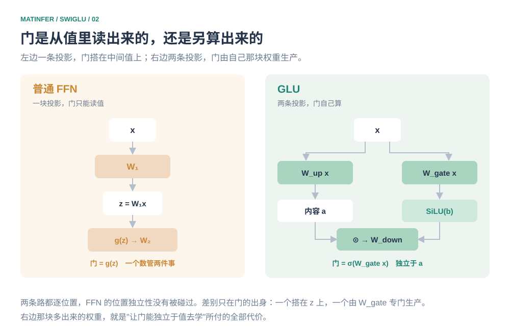
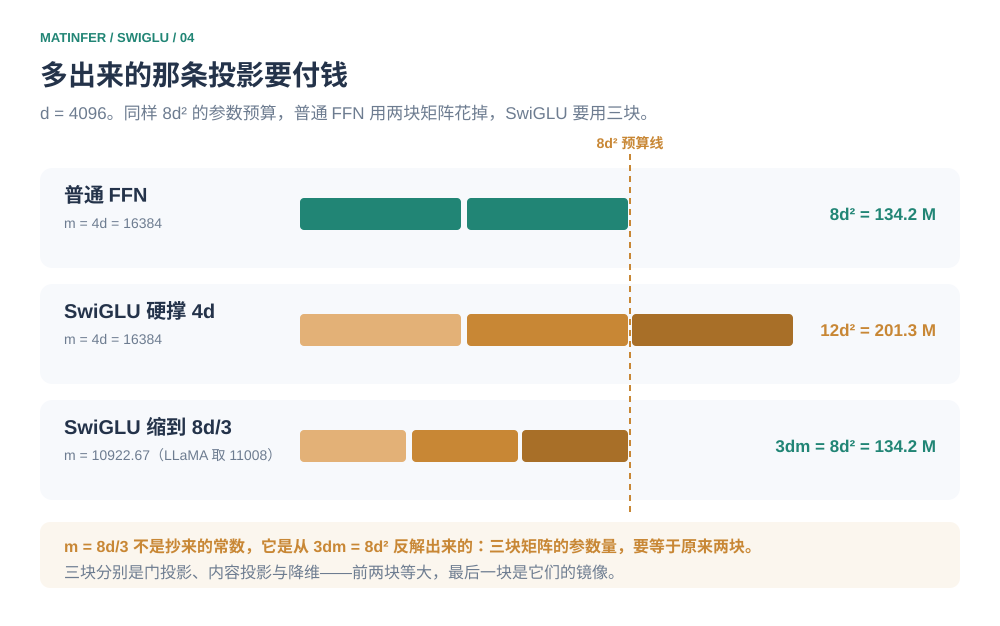
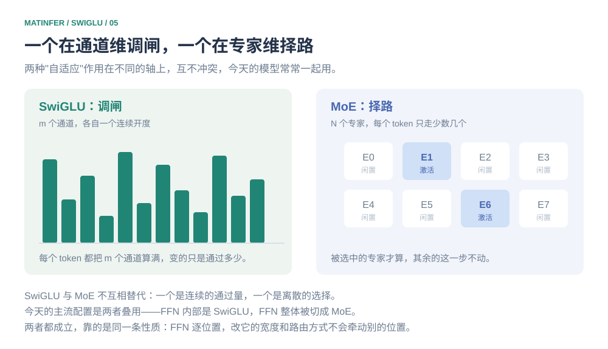

# 门从哪里来：从 ReLU 到 SwiGLU

2017 年，Vaswani 那篇论文里的前馈网络是两层全连接夹一个 ReLU：$u\to\operatorname{ReLU}(uW_1)\to\cdot W_2$。三年后，同一批人在 T5 上把中间这个非线性换着试了一遍，最后发现最有效的一招不是换一条新曲线，而是加一道乘法。再过两年，PaLM 用了它，LLaMA 用了它；等到把今天某个开源模型的权重文件摊开来看，前馈层一律长成 `gate_proj`、`up_proj`、`down_proj` 三块矩阵。

前后换掉的并不是"曲线的形状"。ReLU 那条折线、GELU 那条平滑曲线，谁都不比谁更像一个"正确的激活函数"——它们是同一件事的三种口味，彼此只差一个曲线的圆滑度。

换掉的是另一个问题：**这个通道该通过多少，由谁说了算。**

先把答案摆出来。ReLU、GELU、SiLU（也就是 Swish）三个式子并排写在一起，会看到它们共用一个模板：

```math
\operatorname{ReLU}(z)=z\cdot\mathbf 1\{z>0\},\qquad
\operatorname{GELU}(z)=z\cdot\Phi(z),\qquad
\operatorname{SiLU}(z)=z\cdot\sigma(z).
```

左边那个 $z$ 是这一通道的中间值，紧跟着一个因子——它就是"通过量"。三种激活的区别全落在最后这个因子上：一个阶跃、一个标准正态分布函数 $\Phi$、一个 Sigmoid $\sigma$。而无论换成哪一个，**这个因子都只是 $z$ 自己的函数**，曲线的形状在训练开始之前就定死了。

门控线性单元（Gated Linear Unit，**GLU**）只做了一件事：把这个因子从"$z$ 自己的函数"换成"另一条投影算出来的数"。下面只做一件事——把这条替换当成唯一的根，看它能长出多少东西来：为什么 FFN 要多出一块矩阵，为什么中间维要从 $4d$ 缩到 $\tfrac83 d$，以及它凭什么替换掉一个用惯了的激活函数。

## 挤压

在 ReLU 之前，隐藏层的默认选择是 Sigmoid 和 Tanh。它们做的是同一件事：把输入按到一段有限的区间里——Sigmoid 到 $(0,1)$，Tanh 到 $(-1,1)$。这个动作本身有用，它让每一层的输出有界，网络不会一层层放大到失控。

代价出在两端。输入往任一方向稍微走远一点，曲线就贴上了上下界、进入饱和区，导数趋近于零。反向传播里，梯度是一层层乘回前面的，一个导数接近零的环节会把前面所有梯度一起按到零——这就是当年"深层网络训不动"的直接原因，不是网络太深记不住，而是传到前面的信号已经没了。Tanh 还额外把输出卡在零附近对称，Sigmoid 则只输出正数，让下一层的输入整体偏置到一个方向，收敛更慢。

ReLU 换掉了整个思路。它不在两端做压缩，只在原点处折一下：

```math
\operatorname{ReLU}(z)=\max(0,z).
```

正的一侧原样放行，负的一侧直接归零。正半轴上的导数恒等于 1，梯度不会在途中衰减；计算上只需要一次比较、一次取大，比两个指数便宜得多。等到 2012 年 AlexNet 把它用在深卷积网络上，这条路就算走通了。2017 年原版 Transformer 的前馈层用的就是它，写成 $\operatorname{FFN}(u)=\operatorname{ReLU}(uW_1)W_2$，中间维取到 $4d$。

但 ReLU 留下了一条硬折线。

## 把阶跃磨圆

回看那个模板。ReLU 的门是 $\mathbf 1\{z>0\}$，只取两个值：输入一旦转负，整个通道瞬间断电，中间没有任何过渡。在 $z=0$ 处函数不可导，正向走一步、反向走一步，斜率从一个数跳到另一个数。这种"硬"不是美观问题，它让通道只有开和关两档，很难表达"这个特征在，但只应该放一点点过去"。

2016 年，Hendrycks 和 Gimpel 给出的办法是把这道阶跃换成一条平滑上升的曲线——用标准正态分布的累积分布函数 $\Phi(z)$ 当门。$z$ 越大门越开，$z$ 取小负数时门只是接近关，还留着一条缝。这就是高斯误差线性单元（**GELU**）。它的形状和 ReLU 很接近，区别全在原点附近：那里 ReLU 是一刀切，GELU 是一段斜坡。BERT、GPT-2 那一代模型用的就是它。

另一条路上是一次搜索。2017 年，Ramachandran 等人不去凭直觉设计曲线，而是把 $z\cdot\sigma(\beta z)$ 这类带参数的候选公式交给算法在一堆任务上筛，捞出来的最优解恰好落在 $\beta=1$。这就是 Swish，后来更常被叫作 Sigmoid 线性单元（**SiLU**）——它就是 $z$ 乘上自己的 Sigmoid：

```math
\operatorname{SiLU}(z)=z\,\sigma(z),\qquad \sigma(z)=\frac{1}{1+e^{-z}}.
```

它和 GELU 都属于"平滑激活"，但形式更简单：一个 Sigmoid 乘法，没有误差函数。

到这里，三种激活的关系就摆平了：它们是同一个模板 $z\cdot g(z)$ 下三种不同的门函数。图 1 把两条曲线分开画——上面是激活本身，下面是那个因子 $g$。



*图 1　ReLU、GELU、SiLU 都是 $z\cdot g(z)$。上排是激活曲线，下排是门函数 $g$：一个是阶跃、一个是 $\Phi$、一个是 $\sigma$，都只以 $z$ 为自变量。*

## 门被写死

把三个门函数叠在一起看，会发现一条共同的性质：它们都是 $z$ 的单调递增函数。$\mathbf 1\{z>0\}$ 是，$\Phi$ 是，$\sigma$ 也是。单调意味着**值和通过量被绑在了同一根绳上**——一个通道的中间值越大，它通过的比例就越大，没有例外。ReLU 更极端，门只有 0 和 1 两个取值：$z$ 的符号一变，通道不是全开就是全关。

模型当然可以在训练里调整，但它能调的只有两样东西：这个通道的中间值是多少（改 $W_1$），以及它的输出被加权多少（改 $W_2$）。门曲线本身是选定的，改不动。

于是有些想要的效果就写不出来。想让一个通道通过九成，唯一的办法是把它的中间值顶得很高；可一旦顶高，这个通道在输出里的分量也跟着变大，想压都压不住。反过来，想让某个通道老实待着别抢戏，就得把中间值压低，可门也跟着关小了。"通过多少"和"值多大"这两件事，在这里是一件事。

真正缺的，是一个能独立于值去决定开度的量。

## 另起一条支路

2016 年，Dauphin 等人在门控卷积网络里提出了 GLU。这里值得替演进图说句公道话：GLU 和 GELU 都在 2016 年，Swish 还要再等一年，"先有更好的激活、再出门控"这条顺序其实是事后归因。真实情况是两条线一直并行——一条在磨圆那道阶跃，一条在想怎么让通道自己决定开度，真正合流要到 2020 年。

做法很直接：不再让输入只走一条投影，而是把它投影成两条——

```math
a=W_a x,\qquad b=W_b x,\qquad y=a\odot\sigma(b).
```

$a$ 是内容，$b$ 专门用来产门，两者逐元素相乘。关键不在那个 $\odot$（逐元素乘法早就在用了），而在于 $b$ 来自**另一块权重**。$W_a$ 和 $W_b$ 各自独立，谁也不用将就谁。门想要的"什么样的输入模式该开门"，现在可以由 $W_b$ 自己学出来，跟 $W_a$ 决定的内容完全脱钩。

这就是 GLU 与普通激活最本质的区别：不再只是"每个神经元各自过一遍激活函数"，而是让一条支路动态地决定另一条支路的信息该通过多少。值和通过量从"同一个数的两个函数"，变成了"两个独立的数"。



*图 2　左：普通 FFN，门是从中间值 $z$ 上读出来的，只有一条投影。右：GLU，门由 $W_b$ 单独算出来，与内容 $W_a x$ 互不约束。*

## 一次对照

道理说到这儿都还抽象，取一行具体数字过一遍。设 $d=2$，输入 $x=[1,2]$；把内容支路取成恒等（$W_{up}$ 用单位阵），这样 $u=x$，差别就全落在门上。

普通 FFN 的门是值的函数。拿 SiLU 的结构说，门就是 $\sigma(u_i)$：

```math
\sigma(1)=0.7311,\qquad \sigma(2)=0.8808.
```

值大的通道，门也大——这正是上一节说的那根绳子。

GLU 的门另算。先用它最早的 Sigmoid 门把数字走通（换成 SwiGLU 的 SiLU 门在下一节，数值差异见附录 A）。取

```math
W_{gate}=\begin{bmatrix}\ln 9 & 0\\ \ln 3 & 0\end{bmatrix}
\quad\Longrightarrow\quad
g=W_{gate}x=[\ln 9,\ \ln 3],\qquad
\sigma(g)=\left[\tfrac{9}{10},\ \tfrac34\right].
```

写成 $\ln$ 是为了让 $\sigma$ 落回整分数：$\sigma(\ln 9)=\frac{9}{1+9}=\frac9{10}$，$\sigma(\ln 3)=\frac{3}{1+3}=\frac34$，手算就能核。输出于是是

```math
y=u\odot\sigma(g)=\left[1\cdot\tfrac9{10},\ 2\cdot\tfrac34\right]=[0.9,\ 1.5].
```

把两组门并排摆着看：通道 1 的值是 $1$，比通道 2 的 $2$ 小，可它的门 $0.9$ 反而比 $0.75$ 大。**同向关系被打破了。** 而这件事在 $z\cdot g(z)$ 的模板里永远做不到：那里 $\sigma$ 单调递增，值小门必然小。换成 ReLU 更干脆，两个通道的中间值都是正的，门只能给出 $[1,1]$，连调节的余地都没有。

## 门里放什么

门既然是一条独立支路，那这条支路上用什么非线性就成了一个可以换的零件。GLU 最初用 $\sigma$，图的是它的输出落在 $(0,1)$，像一个开度。后来发现没有必要——只要能给出一个逐元素的缩放，用哪个激活都行：

```math
\text{ReGLU}: a\odot\operatorname{ReLU}(b),\qquad
\text{GEGLU}: a\odot\operatorname{GELU}(b),\qquad
\text{SwiGLU}: a\odot\operatorname{SiLU}(b).
```

2020 年，Shazeer 把这些变体在 T5 上逐一对比，结论是 GEGLU 与 SwiGLU 明显好过其余，也都好过原来的 ReLU / GELU 前馈网络。名字也好拼：SwiGLU 就是 **Swish 门控线性单元**（Swish Gated Linear Unit），把 Swish 塞进 GLU 的槽位。它此后成了事实标准——PaLM 用了它，LLaMA 跟上，Qwen、DeepSeek 的 FFN 也是这个形状。

GEGLU 和 SwiGLU 之间那点差距，笔者觉得不值得纠缠。看图 1 下排就明白：$\Phi$ 与 $\sigma$ 在 0 附近的曲线本来就贴在一起，换成哪一个，门的行为差不出多少。最后定下 SwiGLU 更多是工程原因——Sigmoid 的算子比误差函数更便宜、也更早被各家 kernel 优化好——而不是它本身更优。

在 Transformer 里，它通常写成三个矩阵的样子：

```math
\operatorname{FFN}_{\mathrm{SwiGLU}}(x)=W_{down}\Big[\operatorname{SiLU}(W_{gate}x)\odot(W_{up}x)\Big].
```

图 3 是这条数据流。一句话概括它与普通 FFN 的差别：**ReLU 和 GELU 是"对一个值做非线性"，SwiGLU 是"用一条支路生成门，动态控制另一条支路的信息流"。** 前半句里门是读出来的，后半句里门是算出来的——这一点差别，就是全篇的主线。



*图 3　SwiGLU 的前向路径（动画）。信号先分两路投影，门支路过 SiLU 得到开度，与内容支路逐元素相乘，最后由 $W_{down}$ 投回原维度。*

## 多出来的一条投影要付钱

门控不是白拿的。普通 FFN 两块矩阵，SwiGLU 三块，参数量差一块 $dm$：

```math
\text{普通 FFN}: d\to m\to d \;\Rightarrow\; 2dm,
\qquad
\text{SwiGLU}: 3dm.
```

如果还按老规矩取 $m=4d$，参数量就从 $8d^2$ 涨到 $12d^2$，凭空多出一半。这不是设计者想要的——换激活不该顺带换掉模型的规模。于是一个很自然的动作：把 $m$ 调小，让 $3dm$ 回到 $8d^2$：

```math
3dm=8d^2\quad\Longrightarrow\quad m=\frac{8d}{3}\approx 2.67\,d .
```

这个 $\tfrac83$ 不是抄来的常数，它是从"三块矩阵的参数量要等于原来的两块"这条约束里反解出来的。顺带说一句，$m=\frac83 d$ 这个数我第一次见到时以为是实验试出来的经验值，直到把 $3dm=8d^2$ 一行写出来才看清它有多硬——没有任何可调余地，$d$ 怎么变，$\frac83$ 都不变。

$d=4096$ 时 $m=10922.67$；LLaMA 实际取 $11008$（对齐到 256 的倍数，方便算子切分），比 $8d^2$ 只多 $0.78\%$。图 4 把这三笔账摆在一起。



*图 4　$d=4096$。同样是 $8d^2$ 的预算：普通 FFN 用两块 $d\times m$ 花掉，SwiGLU 要用三块，于是 $m$ 必须从 $4d$ 缩到 $\tfrac83 d$。硬撑 $m=4d$ 就多花一半参数。*

这三块矩阵在权重文件里的名字，就是开头见到的那三个：`gate_proj` 管门，`up_proj` 管内容，`down_proj` 负责投回。它们的形状依次是 $d\times m$、$d\times m$、$m\times d$——前两块等大，最后一块是它们的镜像。

## 闸与路

到这里可以把 FFN 上的两种"自适应"摆在一起看。

SwiGLU 在**通道维**上调闸：给中间层的每个通道算一个连续的开度，大开的通道多输出一点，小开的少输出一点。但它对每个 token 都做了同样多的计算——$m$ 个通道一个不少。

MoE 换了另一个维度：在通道之上再叠一层"选哪几个专家"，让每个 token 只激活少数几个，算力于是不再随总参数增长。一个是在连续地调"通过多少"，一个是在离散地选"走哪条路"。



*图 5　SwiGLU 调的是每个通道的开度（连续、每个 token 都一样多的工作量）；MoE 选的是走哪几个专家（离散、每个 token 只算少数几个）。两者不冲突，今天的模型常常一起用。*

它们并不互相替代。今天的主流配置恰恰是把两者叠起来：FFN 内部是 SwiGLU，FFN 整体被切成 MoE。回到本仓那两篇里也已经见过的判断——FFN 是逐位置的，随机改变它的宽度和路由方式都不会牵动别的位置，所以它敢做门控，也敢做专家拆分；Attention 那边只有 softmax 的分母需要把整行凑齐，动它的代价要高得多。

## 附录 A　参考实现

```python
import torch
import torch.nn as nn
import torch.nn.functional as F


class SwiGLUFFN(nn.Module):
    """最标准的、非合并形式的 SwiGLU 前馈层。三个矩阵，全部无偏置。"""

    def __init__(self, d_model: int, hidden_dim: int):
        super().__init__()
        self.gate_proj = nn.Linear(d_model, hidden_dim, bias=False)  # 门：W_gate
        self.up_proj = nn.Linear(d_model, hidden_dim, bias=False)    # 内容：W_up
        self.down_proj = nn.Linear(hidden_dim, d_model, bias=False)  # 降维：W_down

    def forward(self, x: torch.Tensor) -> torch.Tensor:
        gate = F.silu(self.gate_proj(x))   # 门支路：过 SiLU 得到开度
        up = self.up_proj(x)               # 内容支路
        return self.down_proj(gate * up)   # 逐元素相乘后投回
```

拿同一组权重重放一遍（$W_{up}=W_{down}=I$，$W_{gate}=[[\ln 9,0],[\ln 3,0]]$，输入仍取 $x=[1,2]$）：

```python
m = SwiGLUFFN(2, 2)
with torch.no_grad():
    m.gate_proj.weight.copy_(torch.tensor([[math.log(9), 0.0], [math.log(3), 0.0]]))
    m.up_proj.weight.copy_(torch.eye(2))
    m.down_proj.weight.copy_(torch.eye(2))

m(torch.tensor([[1.0, 2.0]]))   # tensor([[1.9775, 1.6479]])
```

注意这个输出和正文 §一次对照 的 $[0.9,1.5]$ **不一样**，差别全在门函数上。正文那一步用的是 GLU 最早的 Sigmoid 门，$\sigma(\ln 9)=\frac9{10}$、$\sigma(\ln 3)=\frac34$ 恰好落回整分数，手算就能核，所以输出是 $u\odot\sigma(g)=[0.9,\ 1.5]$。SwiGLU 把门换成 $\operatorname{SiLU}(z)=z\,\sigma(z)$，比 Sigmoid 多出一个 $z$ 因子：$\operatorname{SiLU}(\ln 9)=\ln 9\cdot\frac9{10}=1.9775$、$\operatorname{SiLU}(\ln 3)=\ln 3\cdot\frac34=0.8240$，于是 $y=[1.9775,\ 1.6479]$。两组门的**序**没有变（第一个通道的门都更大，而内容 $u=[1,2]$ 是第二个更大），正文要演示的"同向关系被打破"照旧成立，变的只是数值的整齐度——这也是正文用 Sigmoid 而不用 SiLU 举例的原因。

`bias=False` 是第一件值得留意的事。门控 FFN 一般不带偏置——原版 FFN 的 $+b_1,+b_2$ 在这里被去掉了，因为偏置在门控结构里作用有限，而省掉它能让三块矩阵在算子上更整齐。另一个细节是层的顺序：门先过激活、再与内容相乘，写成 `F.silu(gate_proj(x)) * up_proj(x)`；把它和 $\operatorname{SiLU}(W_{gate}x)\odot(W_{up}x)$ 逐项对上，才不会在"哪一路过激活"上写错。

## 附录 B　面试速查

**为什么门控的 FFN 要多一块矩阵？**

因为门必须由一条独立支路算出来。在 $z\cdot g(z)$ 的模板里，门是值的函数，值和开度绑在一起；GLU 用第二块投影 $W_b$ 单独生产门，两者才脱钩。这块矩阵就是"脱钩"的价格。

**SwiGLU 的参数不是更多吗？**

如果保持 $m=4d$，是，$8d^2\to12d^2$。实践里把 $m$ 缩到 $\tfrac83 d$，让 $3dm=8d^2$，参数量回到原地。所以 SwiGLU 与普通 FFN 是同样的参数量预算，换了一种花法。

**为什么中间维是 $8/3\,d$ 而不是 $4d$？**

它是 $3dm=8d^2$ 反解出来的，不是经验常数。LLaMA 取 $11008$ 是把它对齐到 256 的倍数，方便算子切分。

**ReLU、GELU、SiLU 的差别到底在哪？**

同一个模板 $z\cdot g(z)$ 下三种门函数。ReLU 的门是阶跃、只有 0 和 1；GELU 用 $\Phi$、SiLU 用 $\sigma$，都是把阶跃磨成斜坡。它们的共同点比差别更重要——门都写死为 $z$ 的函数。

**为什么现在大模型都用 SwiGLU？**

因为它让门可以跟着当前 token 的 hidden state 走。Shazeer 2020 的对比里，SwiGLU 与 GEGLU 好过 ReLU / GELU 前馈网络，此后 PaLM、LLaMA、Qwen、DeepSeek 一路沿用。

**门控会引入新的跨位置依赖吗？**

不会。两条支路都是逐位置的线性投影，逐元素相乘也是逐位置的，FFN 的位置独立性一点没动。
