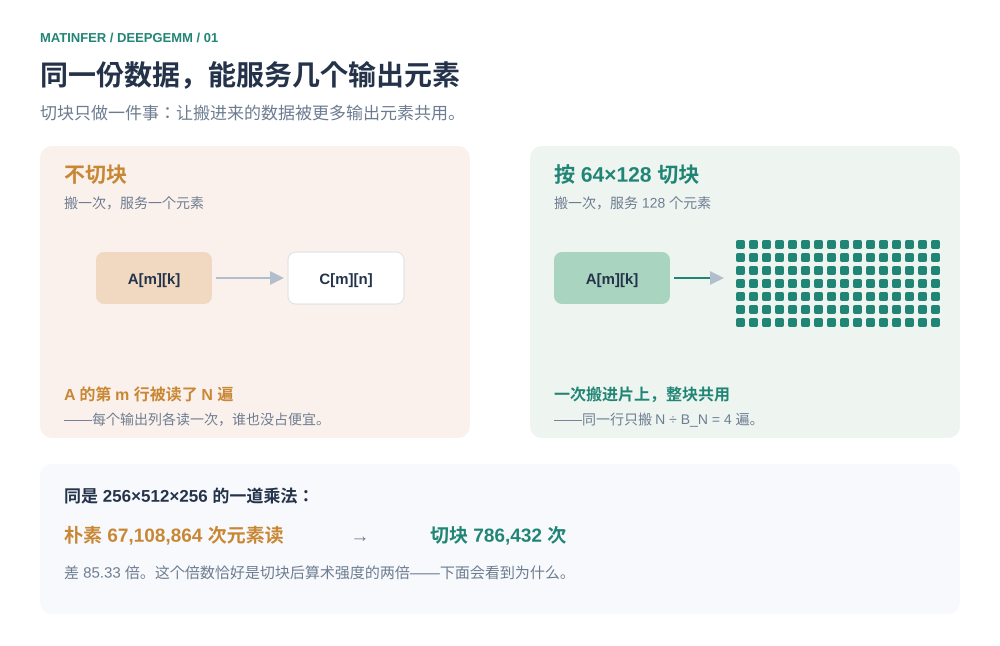
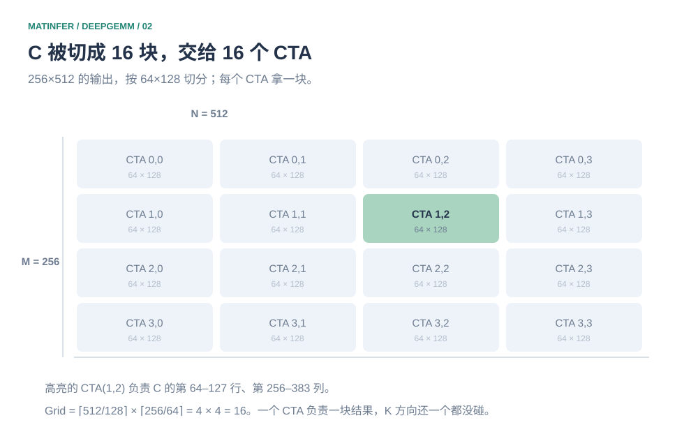
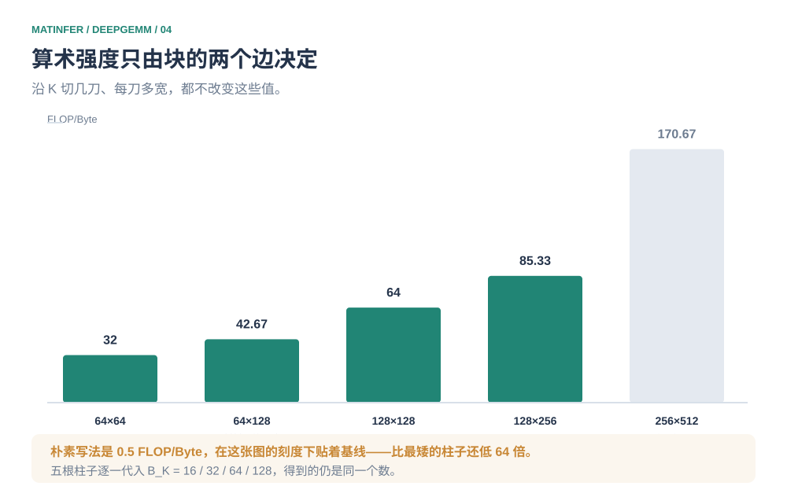
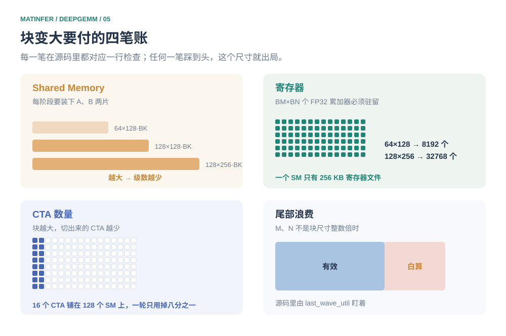

# 第一刀切在哪：DeepGEMM 的 CTA Tiling

2026 年 9 月，DeepGEMM 的 README 里有一句话值得单独拎出来。它说这个库是"designed for simplicity, with only a limited number of core kernel functions"，给自己的定位是"a clean and accessible resource for learning NVIDIA GPU kernel optimization techniques"。

它现在装的是 FP8、FP4、BF16 三类 GEMM，加上 MoE Grouped GEMM 和一批量化融合算子。

一个在 H800 上跑到 1550 TFLOPS（FP8 口径）的库，主动说自己是拿来学的。这种姿态不常见，但它敢这么说是有底气的：`csrc/jit_kernels/heuristics/` 下决定"一个矩阵形状该用哪组分块参数"的那个文件是 248 行，读完就能从矩阵形状一路推到分块尺寸、swizzle 模式、流水线级数和线程数四组参数。

小，而且不慢，通常只有一种解释：**这里的参数不是调出来的，是从约束里解出来的。**

先立起整篇要用的那一条。算输出矩阵的一个元素 $C[m][n]$，需要 $A$ 的第 $m$ 行和 $B$ 的第 $n$ 列。不切块的时候，每个输出元素各读一遍，同一段数据被反复搬运。切块做的事只有一件：**让搬进来的数据被更多输出元素共用。** 衡量它划不划算的也只有一个数——每读一个字节能做多少次浮点运算。后面所有内容，Grid 为什么长成那个形状、$BK$ 为什么是那个值、块为什么不能无限大，全是这一条的推论。

往下走会依次经过五层，本文只做第一层。

| 层 | 要回答的问题 |
| --- | --- |
| CTA Tiling | 大矩阵切成多大的块，交给多少个 CTA |
| Warp Tiling | 一个 CTA 里的几个 Warp 怎么分这块 |
| MMA Tiling | 落到硬件上是什么形状的 Tensor Core 指令 |
| Memory Optimization | 数据怎么从 Global 经 Shared 到 Tensor Core |
| Pipeline Optimization | 搬运怎么和计算重叠 |

## 先看不切块的样子

取一组具体形状：$A$ 是 $256\times256$，$B$ 是 $256\times512$，$C=AB$ 就是 $256\times512$。也就是 $M=256$、$N=512$、$K=256$。

最直接的写法是一个线程算一个输出元素：

```cpp
float sum = 0.0f;
for (int k = 0; k < K; k++)
    sum += A[row * K + k] * B[k * N + col];
C[row * N + col] = sum;
```

这段代码有两个毛病，但第二个盖过第一个。先说第一个：$A$ 的第 $m$ 行会被 $C$ 第 $m$ 行的全部 512 个元素用到，$B$ 的第 $n$ 列会被 $C$ 第 $n$ 列的全部 256 个元素用到，而这里每个线程都自己读一遍，谁也没占谁的便宜。

第二个毛病更致命：**它压根没用 Tensor Core。** 逐元素标量乘加走的是 CUDA Core，而如今一张卡上真正值钱的算力在 Tensor Core 那边。这个毛病的修法和第一个是同一个——都得靠分块。

把代价先算出来。FP16 输入、FP32 累加，每个输出元素要读 $2K=512$ 个 fp16、也就是 1024 字节，做 $2K=512$ 次浮点。于是

```math
\mathrm{AI}_{\text{朴素}} = \frac{512\ \text{FLOP}}{1024\ \text{B}} = 0.5\ \text{FLOP/B}
```

拿 H100 那一代做参照：FP16 dense 峰值算力和 HBM 带宽的比值在 300 上下（989 TFLOPS / 3.35 TB/s，不含稀疏）。也就是说硬件每读到 1 个字节，有能力做 300 次浮点——而这个写法只做了 0.5 次。**不是慢一点，是差三个数量级。**

## 把共用变成只读一次

现在换个组织方式。不再让每个线程各自去读，而是让一块数据被搬进片上之后，被尽可能多的输出元素共用。

$A$ 的第 $m$ 行，一旦为 $C$ 的第 $m$ 行服务，就该被这行的所有列一起用；$B$ 的第 $n$ 列同理。所以把输出切成方块，一块交给一个协作单元：



*图 1　复用的来源。不切块时 $A$ 的每一行被读 $N$ 遍；切块后只读 $N/B_N$ 遍。*

效果可以数出来。理想情况下（假设片上有无限缓存），$A$ 的每个元素只被 $N/B_N$ 个列块读到，$B$ 的每个元素只被 $M/B_M$ 个行块读到：

```math
\text{读入次数}_{\text{朴素}} = MN \cdot 2K = 67{,}108{,}864
```

```math
\text{读入次数}_{\text{切块}} = MK\cdot\frac{N}{B_N} + KN\cdot\frac{M}{B_M} = 786{,}432
```

同一道乘法，元素读取次数从 6710 万降到 78.6 万，**差 85.33 倍**。这个倍数不是巧合——它恰好是切块后算术强度的两倍，后面会看到为什么。

不过要先把话说在前面：这是**理想口径**。它假设搬进来的每一份数据都被完整复用，既没有算 L1/L2 命中，也不等于真实的显存流量——真实数字还要受内存布局、数据驻留和调度的影响，跟这个倍数差得远。它值钱的地方在于给出了复用效率的上界，以及说清了这份效率是从哪里来的。

## 第一刀切在哪

现在要定 $B_M$、$B_N$、$B_K$ 三个数。先定前两个。

材料里给的选择是 $B_M=64$、$B_N=128$。那么 $C$ 的 256 行被切成 $256/64=4$ 条，512 列被切成 $512/128=4$ 段，网格是 $4\times4$：



*图 2　$C$ 的切分。每个 CTA 负责一个 $64\times128$ 的输出块。*

对应的启动配置就是一句很短的代码：

```cpp
dim3 grid((N + BN - 1) / BN, (M + BM - 1) / BM);
```

三个参数里，为什么先定这两个？因为它们决定的是**结果怎么分**，而 $B_K$ 决定的是**过程怎么走**。结果的分法定下来，每个 CTA 负责哪一块就定了，剩下的都是它自己的事。反过来先定 $B_K$ 是没有意义的——你还不知道这块有多大，无从判断一次搬进来多少才合适。

那行代码里 `grid.x` 是 $N$ 方向、`grid.y` 是 $M$ 方向，这个顺序也不是随便排的。GPU 派发 CTA 时 $x$ 维走得最快，于是相邻派发的那些 CTA 共享 $A$ 的同一段行，L2 里有很大机会是同一份数据。

这里还有个容易滑过去的地方：**一个 CTA 拿到 $64\times128$ 的输出块，不等于它一次就算完了。** 它只确定了自己要负责哪一块结果，$K$ 方向的 256 个元素还一个都没碰。

## 为什么还要沿 K 再切一刀

只关注其中一个 CTA。它的输出块是 $64\times128$，但为了算出这个块，它需要 $A$ 的 $64\times256$ 和 $B$ 的 $256\times128$。

把这两个输入块搬到片上要多少地方？FP16 下分别是 32 KB 和 64 KB，加起来 96 KB。

Hopper 一块 SM 的 shared memory 是 227 KB（源码里写死的 `smem_capacity = 232448`），96 KB 看上去放得下。但那只够放**一个**阶段，而流水线至少要三个阶段才藏得住 TMA 的延迟——这不是经验，是源码里的一行硬条件：`if (num_stages < 3 or ...) continue;`，级数不够的候选组合直接被淘汰。$96 \times 3 = 288$ KB，超了。

于是沿 $K$ 方向再切一刀。取 $B_K=32$，一个阶段就只要 $64\times32\times2 + 32\times128\times2 = 12288$ 字节，也就是 12 KB。$K$ 方向循环 $256/32=8$ 次，每次把新的两片搬进来，累加到同一组寄存器上：


*图 3　沿 $K$ 的循环。8 个分块轮流进片上，累加器不动，输出只在最后写回一次。*

这里要纠正一个常见的说法。$B_K$ 不是"每次算多宽"，那是计算侧的视角。**存储侧的视角才是它的来历：它决定了每个流水线阶段要往片上搬多少数据。** 计算真正做的事情，是把这 8 次累加串起来；而搬进来的 12 KB，换来的是 $524{,}288$ 次浮点运算。

骨架只有这四行：

```cpp
for (int k0 = 0; k0 < K; k0 += BK) {
    load_A_tile();        // 64 × 32
    load_B_tile();        // 32 × 128
    mma_accumulate();     // 累加进寄存器里的 C_tile
}
store_C_tile();           // 64 × 128，只写一次
```

`mma_accumulate()` 在这里只是示意。真实的内核里，一个 CTA Tile 要组织很多次 Tensor Core 操作才算得完——那是第三层的事，这四行只负责说清楚"累加器不动、输出最后才落盘"。

## 那个把 K 消掉的式子

现在可以算清楚切块到底赚在哪。只看一个 $K$ 分块：

```math
\mathrm{AI} = \frac{2 \cdot B_M B_N B_K}{2 B_M B_K + 2 B_K B_N}
= \frac{2 B_M B_N B_K}{2 B_K (B_M + B_N)}
= \frac{B_M B_N}{B_M + B_N}
```

**$B_K$ 不见了。** 数据位宽也不见了——只要 $A$、$B$ 同类型，分子分母各自的那个 2 一起约掉。整个 $K$ 循环算下来也一样：总读入是 $(B_M+B_N)K$ 个元素，总运算是 $2B_MB_NK$，$K$ 跟着消掉。

这句是我认为本篇最值得记住的：**分块的算术强度只由 $B_M$ 和 $B_N$ 决定。** 沿 $K$ 切几刀、每刀多宽，只影响循环几次、片上占多少，不影响复用效率。

代回那组数：$64 \times 128 / (64+128) = 42.67$，等于 $128/3$。这就是前面那个 $524288/12288$ 的真正来路——它跟 $B_K=32$ 一点关系都没有，换成 $B_K=16$ 或 $64$，这个数一模一样。



*图 4　$B_M B_N/(B_M+B_N)$ 的取值。朴素写法落在 0.5 那条线上。*

顺手把写回也算进去。真实的一个 CTA 还要把 $64\times128$ 的结果写出去：

```math
\mathrm{AI}_{\text{含写回}} = \frac{B_M B_N K}{(B_M + B_N) K + B_M B_N}
```

$K=256$ 时它等于 36.57，比 42.67 低；$K$ 涨到 4096 时回到 42.23。所以**同样两个块尺寸，$K$ 越大的矩阵越容易打满硬件**——写回那一次搬运被摊得越薄。这个规律在推理里很实在：权重矩阵的那个维度通常就是几千。

## 块越大越好吗

式子里 $B_M$、$B_N$ 都是单调递增的：$128\times256$ 的 85.33 比 $64\times128$ 的 42.67 高出一倍，$256\times512$ 更高。那为什么不干脆切得再大一点？

因为复用只是这场交易的一边。块变大要同时付四笔账——片上缓存更占地方、寄存器更紧张、切出来的 CTA 更少、边缘那一圈白算的更多：



*图 5　块尺寸的四条上限。任何一条踩到头，这个尺寸就出局。*

第三笔账值得单独看一眼。$C$ 只有 16 个 CTA，而 RTX 4090 有 128 个 SM——**一轮下来三分之二的 SM 闲着**，得等第二轮。

所以调块尺寸从来不是"越大越好"的优化题，而是"数据复用 + 硬件资源占用 + GPU 并行度"三者之间的配平。上面是道理，DeepGEMM 里是四行代码。

## 寄存器那条线

最硬的一条写在文件开头：

```cpp
// The block sizes cannot be too large (for enough registers),
// so at least one dim less than 128
if (block_m > 128 and block_n > 128)
    continue;
```

两维都超过 128 的组合根本不进候选。$B_M \times B_N$ 个 FP32 累加器必须住在寄存器里，$64\times128$ 是 8192 个，$128\times256$ 就是 32768 个，而一个 SM 的寄存器文件只有 256 KB——装不下还得装别的。

它对这个问题的处理方式很值得看：

```cpp
const int num_math_threads = layout.block_m <= 64 ? 128 : 256;
```

**行数翻倍，参与计算的线程数跟着翻倍。** 于是每个线程背的累加器份数被压在 $B_N/2$ 这个量级上——$B_N=128$ 时是 64 个，$B_N=256$ 时是 128 个，都还在 255 个寄存器的上限内。

$64\times128$ 这一块要 8192 个累加器，摊到 128 个线程上就是每人 64 个 FP32，占掉四分之一强的寄存器预算。剩下的四分之三还要留给 $A$、$B$ 的 fragment、地址运算和流水的临时量。两维都往 128 以上走，光累加器就要把整个寄存器文件吃穿——所以那条禁令只允许一维超过 128，不许两维都超。

## 另外三笔账

shared memory 那笔摊在流水线级数上：块切得越大，每个阶段占的地方越多，能开几级自动被挤下来，而级数不到三级的组合会被直接淘汰。

CTA 数量那笔对应 `get_layout_info` 里的 `wave_efficiency`：$16/128$ 的波效率意味着哪怕每个 CTA 都跑满，整机也有一多半在空转。尾部浪费更直白——$M$、$N$ 不是块尺寸整数倍时，最后一个块里有一大半元素是白算的，源码里专门有个 `last_wave_util` 字段在盯它。

所以你最后看到的候选集合长这样：

```cpp
block_m_candidates = {64, 128};
if (desc.m <= 16) block_m_candidates.push_back(16);
if (desc.m <= 32) block_m_candidates.push_back(32);
if (desc.cd_dtype != torch::kFloat) block_m_candidates.push_back(256);
```

$B_M$ 只有 64 和 128 两个常规候选，小矩阵才放开更小的值（避免 TMA 越界），输出不是 FP32 时才允许 256。**候选值本身就已经是被约束筛过一轮的结果**，后面那个枚举只是在缝隙里挑一个。

## 那个不由你决定的参数

$B_K$ 和前面两个不一样。源码里它就一行：

```cpp
const int block_k = 128 * 8 / get_num_element_bits(desc.get_mma_kind());
```

`get_num_element_bits` 把 MMA 类型翻译成位宽，于是

| MMA 类型 | 位宽 | $B_K$ | 一行占的字节 |
| --- | --- | --- | --- |
| BF16 | 16 | 64 | 128 B |
| MXFP8/FP4 | 8 | 128 | 128 B |
| MXF4 | 4 | 256 | 128 B |

最后一列全是 128 字节。这不是巧合：同一个文件里的 `get_swizzle_mode` 从 $\{128, 64, 32, 16\}$ 里挑最大的那个当共享内存的交换粒度，而 $B_K$ 的作用就是让 $A$、$B$ 的一行恰好铺满 128 字节——**$B_K$ 是被 shared memory 的布局约束解出来的，不是调出来的。** 换数据类型，它自己跟着变，你没有任何自由度。

这也解释了为什么本文示例里的 $B_K=32$ 不等于真实内核里的值。$32 \times 2 = 64$ 字节，铺不满 128；选 32 只是为了让 FP16 下的手算整齐。真实内核里 FP16/BF16 的 $B_K$ 是 64，$128\times8\div16$ 直接给出来。

剩下的参数同样是被解出来的，不是被搜出来的。每个阶段要占多少片上空间，源码里是这么算的：

```cpp
const int num_stages = std::min(
    (smem_capacity - smem_extra) / smem_per_stage,
    kNumMaxStages);
```

**先算出一阶段要多少，再用片上总容量反推出能开几级流水**，上限 16 级。块切得越大，单阶段越占地方，级数自动被挤下来；挤到 3 级以下，这个组合就别选了。级数、块尺寸、线程数，三个量在这里互相咬着，一动俱动。


*图 6　三个数字的来处。它们不是搜索出来的，是从各自的约束里解出来的。*

## 这条路的硬件边界

上面所有参数都出自 `sm90.hpp`——那是 Hopper 的路径。换一代硬件，整套东西都不一样：

| 架构 | 计算路径 | 操作数从哪来、结果落在哪 |
| --- | --- | --- |
| Ampere / Ada（3090、4090） | `mma.sync` | 都在寄存器里，按 Warp 组织 |
| Hopper（H800/H100） | `wgmma.mma_async` | 操作数可直接从 Shared Memory 取，配备 TMA 与异步流水 |
| Blackwell（B200 等） | `tcgen05.mma` | 累加器搬进独立的 Tensor Memory |

三条路的分水岭就在这一列：操作数从哪来、结果落在哪。它决定了寄存器预算怎么算、数据要不要绕经 Shared Memory、流水线用什么机制同步。本文的推导全部依附在前两行上。

所以 DeepGEMM 的 README 把硬件要求写死成"NVIDIA SM90 或 SM100 architecture GPU"。4090 是 SM89，Hopper 的 `wgmma` 和 TMA 它都没有，那些 kernel 不能原样搬过来跑。

可 4090 上能验证的东西并不少。分块怎么切、复用从哪来、四笔账怎么配平，这些跟指令集无关。真要动手，可以拿 `mma.sync` 写一个简化版，把本文这些数字对一遍。

## 下一步

$B_M$、$B_N$、$B_K$ 定完，一个 CTA 拿到了 $64\times128$ 的输出块。可它内部有 128 或 256 个线程，这块结果怎么分下去？

这里要连着回答三个问题。这块 $64\times128$ 切成几份、每份交给一个 Warp 还是交给一组 Warp？每个线程负责的那几个元素，在 $A$、$B$、$C$ 里分别长成什么形状的碎片？最后落到硬件上，$m16n8k16$ 这样的指令一次吃多大一块，这些碎片又该怎么摆进寄存器？

第二问最容易被跳过，也最容易出错。前面说每个线程背 $B_N/2$ 个累加器，那说的是**数量**；到这一层才有**位置**——哪个寄存器对应输出块里的哪一格，是硬件和编译器一起定死的，摆错一格结果就错，而且不会报错。

从"会写 CUDA"到"会写 Tensor Core kernel"，真正的门槛在这一层。下一篇文章接着往下走。

## 附录 A　面试速查

**为什么 GEMM 要 tiling？**

为了把同一段数据被多个输出元素共用这件事，从"靠缓存碰运气"变成"显式搬到片上再分"。代价是访存次数从 $MN\cdot2K$ 降到 $MK\cdot N/B_N + KN\cdot M/B_M$，效果就是算术强度上去了。

**$B_K$ 怎么定？**

真实内核里它由数据类型和 shared memory 的 swizzle 原子宽度共同决定，DeepGEMM 里是 $128\times8/\text{位宽}$：BF16 取 64，FP8 取 128，FP4 取 256，保证一行恰好 128 字节。它不是自由调参的对象。

**$B_M$、$B_N$ 为什么不能都很大？**

累加器 $B_M B_N$ 个 FP32 必须驻留寄存器，$128\times128$ 就是 16384 个，加上寻址和中间量会溢出到 Local Memory。四条上限分别是寄存器、shared memory、CTA 数量（并行度）、尾部浪费。

**算术强度和 tiling 是什么关系？**

分块后的算术强度是 $B_M B_N/(B_M+B_N)$，只跟块的两个边有关，跟沿 $K$ 切几刀、跟 $K$ 多长都无关。它跟硬件算力带宽比的差距，就是这道 kernel 能不能打满 Tensor Core 的根本原因。

**为什么说 85.33 倍是理想值？**

它只统计元素读取次数，假设每一份搬进来的数据被完整复用，不考虑 L1/L2 命中与内存布局，也不等于 DRAM 流量。它给出的是复用效率的上界，而真实的显存带宽要另外算。

## 附录 B　把上面的数字重算一遍

```python
from fractions import Fraction as F

M, N, K = 256, 512, 256
BM, BN, BK, ESZ = 64, 128, 32, 2      # ESZ: FP16 = 2 字节

# 1) 朴素写法的算术强度：每个输出读 2K 个元素，做 2K 次浮点
print("朴素 AI =", F(2*K, 2*K*2*ESZ), "FLOP/B")        # 1/2

# 2) 切块后的算术强度：与 BK 无关
for bk in (16, 32, 64, 128):
    a = BM*bk*ESZ; b = bk*BN*ESZ
    flops = 2*BM*BN*bk
    print(f"BK={bk:>3}  AI={F(flops, a+b)}  = {flops/(a+b):.2f}")
# 全是 128/3 ≈ 42.67

# 3) 引擎公式
print("引擎公式 BM*BN/(BM+BN) =", F(BM*BN, BM+BN), "≈", float(F(BM*BN, BM+BN)))
for bm, bn in ((64,64), (64,128), (128,128), (128,256)):
    print(f"  BM={bm:>3}, BN={bn:>3} -> {float(F(bm*bn, bm+bn)):.2f}")

# 4) 含写回输出的完整式
ai = F(BM*BN*K, (BM+BN)*K + BM*BN)
print("含写回 AI =", float(ai))                          # 36.57

# 5) 朴素 vs 切块的元素读取次数
naive = M*N*2*K
tiled = M*K*(N//BN) + K*N*(M//BM)
print(f"朴素 {naive:,}  vs  切块 {tiled:,}  ->  {naive/tiled:.2f}x")

# 6) 累加器与线程（DeepGEMM: block_m<=64 ? 128 : 256）
for bm, th in ((64,128), (128,256)):
    for bn in (128, 256):
        print(f"  BM={bm}, BN={bn} -> {th} 线程 -> {bm*bn//th} 个累加器/线程")
```

**预期输出**：算术强度与 $B_K$ 无关（恒为 $128/3$）；引擎公式给出 32 / 42.67 / 64 / 85.33 四个值；含写回是 36.57；读取次数比 85.33 倍；累加器每线程恒为 $B_N/2$。

$B_M$、$B_N$、$B_K$ 的源码出处是 DeepGEMM 的 [`csrc/jit_kernels/heuristics/sm90.hpp`](https://github.com/deepseek-ai/DeepGEMM/blob/main/csrc/jit_kernels/heuristics/sm90.hpp)（Hopper 路径），`get_num_element_bits` 在 [`utils.hpp`](https://github.com/deepseek-ai/DeepGEMM/blob/main/csrc/jit_kernels/heuristics/utils.hpp)，配置结构体在 [`config.hpp`](https://github.com/deepseek-ai/DeepGEMM/blob/main/csrc/jit_kernels/heuristics/config.hpp)。仓库在 2026 年持续演进，本文数字以 2026 年 10 月的主线为准。
